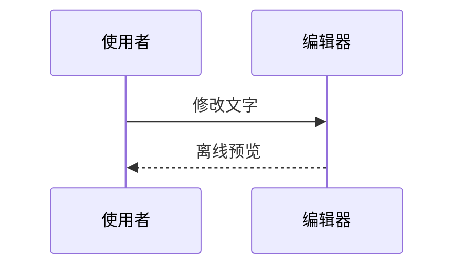

# Directory Studio

把 Chrome 的本地目录和原生文本页变成蓝灰色文件浏览器与离线编辑器。代码和依赖都在一个 userscript 中，不需要运行本地服务。

## 安装

1. 在 Chrome 安装 Tampermonkey。
2. 打开 [安装 Directory Studio](https://raw.githubusercontent.com/wuyixiang9/directory-studio/main/directory-studio.user.js)，在 Tampermonkey 中确认安装。
3. 在 Chrome 的扩展管理页打开 Tampermonkey 的详情，开启“允许访问文件网址”；如果 Chrome 显示“允许用户脚本”选项，也需要开启。较旧 Chrome 可能需要扩展页的开发者模式，按 Tampermonkey 的提示处理。
4. 用 Chrome 打开本地文件夹，或拖入支持的文本文件。
5. 要编辑 `.md` 文件，请禁用已有 Markdown Viewer 等接管 Markdown 的扩展，然后重新打开文件。本脚本不会从已渲染页面反推原文，也不会强行覆盖其他应用页面。

脚本元数据指向本仓库的 `main` 分支，Tampermonkey 可检查更新；也可从 [Releases](https://github.com/wuyixiang9/directory-studio/releases) 选择固定版本。GitHub/Tampermonkey 的安装与更新检查可能联网，但已安装脚本的目录、编辑和图表功能不需要网络。

## 本地目录

- 可点击的完整路径面包屑、磁盘或共享根目录、上一级目录、复制路径。
- 自然数字名称排序、修改时间/大小排序，文件夹始终优先；支持关键词搜索、类型筛选和列表/网格。
- 浅色/深色主题，紧凑布局；可切回原始目录。
- 文件链接保留原生行为，支持 Ctrl-click、中键和上下文菜单；不递归扫描子目录。

快捷键：`/` 聚焦目录搜索；`Escape` 清空或离开搜索；非输入控件内 `Alt+↑` 返回上级目录。

## 文本与代码

支持原生文本页中的 TXT、LOG、Markdown、JSON/JSONC、JavaScript/TypeScript/JSX/TSX、Python、Rust、Go、C/C++、Java、C#、CSS/SCSS、YAML/TOML/INI、Shell、PowerShell、SQL 等。BAT/CMD 等没有专用 lexer 的格式以纯文本显示。XML 只有被 Chrome 作为普通文本打开时可用；HTML、SVG/XML viewer、PDF、图片和未知二进制不会被接管。

- CodeMirror 编辑器提供行号、语法高亮、缩进、括号匹配、撤销/重做与自动换行。
- `Ctrl+F` / `Cmd+F` 查找字面文本；Enter 下一处、Shift+Enter 上一处、Escape 返回编辑器。
- “复制全文”复制当前编辑内容，包括未保存修改；失败时仍可手动全选复制。
- “下载编辑副本”或 `Ctrl+S` / `Cmd+S` 下载如 `notes.edited.md` 的 UTF-8 副本，不覆盖原文件。
- “已修改（仅页面）”表示修改只在当前页；下载和复制不会假称已保存原文件。离开脏页面时请求浏览器确认，撤销回初始内容后恢复“未修改”。浏览器是否显示确认框也取决于其交互策略。
- “原始文本”与“返回编辑器”之间切换不会清空编辑状态。
- JSON 格式化仅在成功验证后替换页面内容；保留数值字面量和重复键，不用解析后重建的方式悄悄舍入大整数。

源内容来自 Chrome 解码后的原生 PRE，不承诺原始编码、BOM 或换行逐字节保留。下载为 UTF-8，换行可能归一化为 LF。文件超过 2 MiB 或 50,000 行时保留原生文本；Markdown 超过 512 KiB 暂停预览。JSON 格式化另有 128 层嵌套和输出大小保护。搜索计数显示至 10,000+。

## Markdown 与 Mermaid

Markdown 提供编辑、预览、分栏；小屏分栏上下排列。普通代码围栏保持代码显示。将围栏语言的第一个词设为 `mermaid`（大小写不敏感）即可渲染图表：

````markdown



````

支持基础流程图、时序图、类图、状态图、ER 图、甘特图、饼图与 Git 图；其余图表类型不在当前支持范围。每个卡片都保留“查看图表源码”，错误会显示文字与源码，不把原文替换成 SVG。

每个图表右上角的“固定高度 / 自动撑开”按钮只控制该图：默认自然撑开，固定后图像区域最多 640px、在图内滚动，短图不会强制留白。切换不会重新渲染或修改编辑内容；相同图表源码及其重复次序在当前页面内保留选择，切换主题、预览方式或修改无关文字不受影响。图表定义变化、移出当前可渲染范围或刷新页面会恢复默认，不保存到磁盘。

每次预览最多渲染 12 个图表，每块不超过 30 KiB，边数配置上限 200；渲染器启动和单图渲染各有 8 秒等待上限。复杂或无效图表可能失败，请简化后重试。超时依赖浏览器能够继续调度事件，不是独立进程的硬 CPU 限额。

图表会按预览区域宽度缩放。甘特图等宽时间轴图在小屏或分栏中可能出现字号过小，建议切换完整“预览”、增大窗口或简化图表；当前不提供图内缩放，不保证所有宽图在紧凑分栏中都易读。

## 安全边界与限制

- 不自动写入、删除、重命名文件，不上传文档，不保存编辑内容到持久存储。仅保存界面偏好。
- Markdown 原始 HTML 不启用；外部图片只显示“未加载”标签，链接仅在用户点击后导航。
- Mermaid 完整依赖离线内置，仅在实际显示 Mermaid 预览时启动隔离 iframe。iframe 只允许脚本，不允许同源权限；CSP 拒绝网络、图片、字体、媒体、子 frame、对象、表单与外部脚本。
- Mermaid 使用 strict 配置，禁止图内配置指令和 frontmatter 配置，不启用图表点击回调。图片、图标包、外部字体、HTML 标签与交互链接不受支持。
- 输出 SVG 先清理活动元素、事件、外部资源与不确定 CSS，再转为本地 Blob 图像显示；不会把图表的 SVG 样式直接插入编辑器页面。唯一自动加载的图像是此受控的本地生成图像，普通 Markdown 图片仍不加载。
- 编辑、主题、视图或页面变化会废弃过时渲染，撤销相关 Blob URL；首次进入预览需要解析内置图表库，可能有短暂等待。不承诺控制浏览器在脚本执行前的首帧。
- 此工具不是操作系统沙箱；请勿把浏览器扩展当作处理不可信文件的完整安全隔离方案。

## 本地维护

需要 Node.js 22.12 或更新版本；不需要 `npm install`。

```sh
node build.mjs
node --test
```

`build.mjs` 确定性生成 `directory-studio.user.js` 和仅含元数据的 `directory-studio.meta.js`。修改 `directory-studio.src.js`、`text-studio.src.js`、`mermaid-studio.src.js`，不要直接编辑生成载荷。依赖来源、版本和 tarball 完整性见 `vendor-manifest.json`，上游原件见 `vendor/`。

Node 测试覆盖 JSON 文本格式化、元数据/生成一致性、确定性、脚本语法及 Mermaid 安全包装的静态约束；不能替代 Chrome 中对实际渲染、CSP、编辑行为和异步竞态的验证。

更新版本时同时调整 `directory-studio.src.js` 的 `@version` 和 `package.json`，更新 `CHANGELOG.md`，重新生成并验证两个载荷，再提交和创建对应的 `vX.Y.Z` tag。仓库不包含自动运行的 Actions；发布者应在验证后再推送和创建 Release。`v1.2.2` 是迁移前的本地源码基线，功能变化见变更记录。

## 许可

仓库自身代码尚未指定许可证，不应默认按第三方的 MIT 许可证解释。CodeMirror、markdown-it 和 Mermaid 包本身附有 MIT 许可；Mermaid standalone 还包含依赖的各自许可声明，请以 `vendor/` 的 LICENSE 与原始 bundle 随附声明为准，不把全部打包依赖归为单一许可证。

_本内容由 wuyixiang 使用 GPT-6.1 Sol 辅助完成。_
