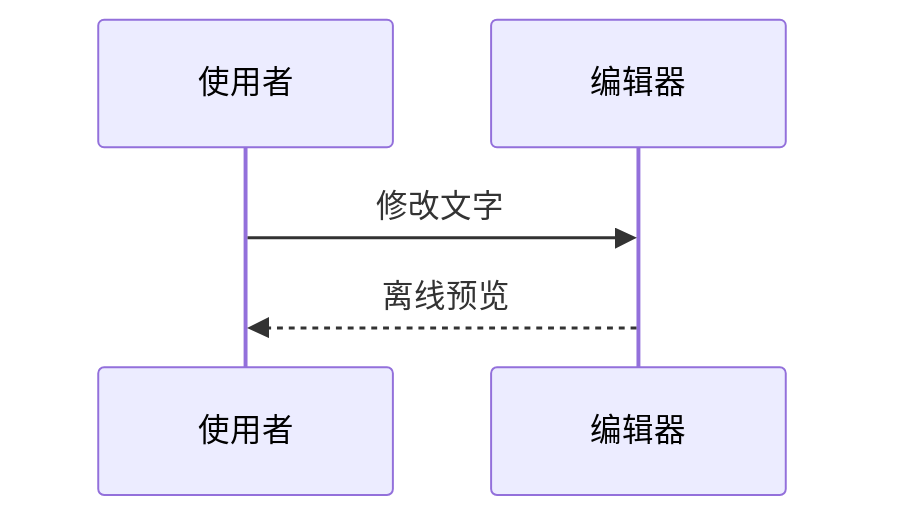

# Directory Studio

把 Chrome 的本地目录和原生文本页变成蓝灰色文件浏览器与离线编辑器。轻量 userscript 负责目录交互；CodeMirror、Markdown 和 Mermaid 资源由 Tampermonkey 在安装或更新时校验并缓存，使用时才按需执行，日常浏览不需要本地服务。

## 安装

1. 在 Chrome 安装 Tampermonkey。
2. 打开 [安装 Directory Studio](https://raw.githubusercontent.com/wuyixiang9/directory-studio/main/directory-studio.user.js)，在 Tampermonkey 中确认安装。
3. 在 Chrome 的扩展管理页打开 Tampermonkey 的详情，开启“允许访问文件网址”；如果 Chrome 显示“允许用户脚本”选项，也需要开启。较旧 Chrome 可能需要扩展页的开发者模式，按 Tampermonkey 的提示处理。
4. 用 Chrome 打开本地文件夹，或拖入支持的文本文件。
5. 要编辑 `.md` 文件，请禁用已有 Markdown Viewer 等接管 Markdown 的扩展，然后重新打开文件。本脚本不会从已渲染页面反推原文，也不会强行覆盖其他应用页面。

脚本的 `@downloadURL` 和 `@updateURL` 指向本仓库 `main` 分支的正式入口，Tampermonkey 可检查更新。安装或更新时需要联网取得脚本及 `resources/<版本>/` 下的四个 SHA-256 固定资源；缓存完整后，目录、编辑和图表功能不需要网络。如果资源下载或校验失败，请联网重新安装或更新，不要删除完整性校验配置。

## 本地目录

- 可点击的完整路径面包屑、磁盘或共享根目录、上一级目录、复制路径。
- 自然数字名称排序、修改时间/大小排序，文件夹始终优先；保留当前目录名称搜索、全部/文件/文件夹切换和列表/网格，每页最多 160 项，不缩减搜索与排序的数据集。
- 浅色/深色主题，紧凑布局；可切回原始目录。
- 文件链接保留原生行为，支持 Ctrl-click、中键和上下文菜单；不递归扫描子目录。
- 收藏常用目录：单行文件夹链接，当前目录轻量高亮；悬停、键盘聚焦或触摸时可用的更多菜单支持重命名标签、上移、下移和取消收藏。改标签不会改目录名，链接保留原生打开行为。
- 支持返回历史项时恢复搜索、范围切换、排序、视图、分页、滚动锚点与焦点；不恢复已移除的目录快速预览或类型/时间条件。本版本不提供目录侧栏预览和增强类型/时间筛选，完整 Markdown 编辑与预览在打开文件后使用。

快捷键：`/` 聚焦目录搜索；`Escape` 清空或离开搜索；非输入控件内 `Alt+↑` 返回上级目录。

## 文本与代码

支持原生文本页中的 TXT、LOG、Markdown、JSON/JSONC、JavaScript/TypeScript/JSX/TSX、Python、Rust、Go、C/C++、Java、C#、CSS/SCSS、YAML/TOML/INI、Shell、PowerShell、SQL 等。BAT/CMD 等没有专用 lexer 的格式以纯文本显示。XML 只有被 Chrome 作为普通文本打开时可用；HTML、SVG/XML viewer、PDF、图片和未知二进制不会被接管。

- CodeMirror 编辑器提供行号、语法高亮、缩进、括号匹配、撤销/重做与自动换行。
- `Ctrl+F` / `Cmd+F` 查找字面文本；Enter 下一处、Shift+Enter 上一处、Escape 返回编辑器。
- “复制全文”复制当前编辑内容，包括未保存修改；失败时仍可手动全选复制。
- “下载编辑副本”或 `Ctrl+S` / `Cmd+S` 下载如 `notes.edited.md` 的 UTF-8 副本，不覆盖原文件。
- “已修改（仅页面）”表示修改只在当前页；下载和复制不会假称已保存原文件。离开脏页面时请求浏览器确认，撤销回初始内容后恢复“未修改”。浏览器是否显示确认框也取决于其交互策略。
- “原始文本”与“返回编辑器”之间切换不会清空编辑状态。
- JSON 格式化仅在成功验证后替换页面内容；保留数值字面量和重复键，不用解析后重建的方式悄悄舍入大整数。

源内容来自 Chrome 解码后的原生 PRE，不承诺原始编码、BOM 或换行逐字节保留。下载为 UTF-8，换行可能归一化为 LF。文件超过 2 MiB 或 50,000 行时保留原生文本；Markdown 超过 512 KiB 暂停预览。JSON 格式化另有 128 层嵌套和输出大小保护。搜索计数显示至 10,000+。

## Markdown 与 Mermaid

Markdown 提供编辑、预览、分栏；小屏分栏上下排列。普通代码围栏保持代码显示。将围栏语言的第一个词设为 `mermaid`（大小写不敏感）即可渲染图表：

````markdown



````

支持基础流程图、时序图、类图、状态图、ER 图、甘特图、饼图与 Git 图；其余图表类型不在当前支持范围。每个卡片都保留“查看图表源码”，错误会显示文字与源码，不把原文替换成 SVG。

每个图表右上角的“固定高度 / 自动撑开”按钮只控制该图：默认自然撑开，固定后图像区域最多 640px、在图内滚动，短图不会强制留白。切换不会重新渲染或修改编辑内容；相同图表源码及其重复次序在当前页面内保留选择，切换主题、预览方式或修改无关文字不受影响。图表定义变化、移出当前可渲染范围或刷新页面会恢复默认，不保存到磁盘。

每次预览最多渲染 12 个图表，每块不超过 30 KiB，边数配置上限 200；渲染器启动和单图渲染各有 8 秒等待上限。复杂或无效图表可能失败，请简化后重试。超时依赖浏览器能够继续调度事件，不是独立进程的硬 CPU 限额。

图表会按预览区域宽度缩放。甘特图等宽时间轴图在小屏或分栏中可能出现字号过小，建议切换完整“预览”、增大窗口或简化图表；当前不提供图内缩放，不保证所有宽图在紧凑分栏中都易读。

## 安全边界与限制

- 不自动写入、删除、重命名文件，不上传文档，不保存编辑内容到持久存储。保存界面偏好和收藏目录路径/标签；返回位置使用当前历史项状态，不保存文件正文。
- Markdown 原始 HTML 不启用；外部图片只显示“未加载”标签，链接仅在用户点击后导航。
- Mermaid 完整依赖随版本分发并在安装或更新时缓存，仅在实际显示 Mermaid 图表时按需加载并启动隔离 iframe；正文先显示，再调度图表。iframe 只允许脚本，不允许同源权限；CSP 拒绝网络、图片、字体、媒体、子 frame、对象、表单与外部脚本。
- Mermaid 使用 strict 配置，禁止图内配置指令和 frontmatter 配置，不启用图表点击回调。图片、图标包、外部字体、HTML 标签与交互链接不受支持。
- 输出 SVG 先清理活动元素、事件、外部资源与不确定 CSS，再转为本地 Blob 图像显示；不会把图表的 SVG 样式直接插入编辑器页面。唯一自动加载的图像是此受控的本地生成图像，普通 Markdown 图片仍不加载。
- 编辑、主题、视图或页面变化会废弃过时渲染，撤销相关 Blob URL；首次图表显示需要解析缓存的库，可能有短暂等待。轻量入口或更小文件不等于整体更快，不承诺浏览器首帧或所有操作的性能改善。
- 此工具不是操作系统沙箱；请勿把浏览器扩展当作处理不可信文件的完整安全隔离方案。

## 本地维护

需要 Node.js 22.12 或更新版本；不需要 `npm install`。

```sh
node build.mjs
node --test
```

`node build.mjs` 默认生成正式的 `directory-studio.user.js`、仅含元数据的 `directory-studio.meta.js`，以及 `resources/1.4.0/` 下的 `editor.js`、`editor.css`、`markdown.js`、`mermaid.js`。正式入口通过 GitHub raw 的版本化路径引用资源，并保留 SHA-256 SRI；四个资源必须与两个入口一起提交。不要直接编辑生成文件，修改相应 `.src.js` 后重新生成。依赖来源、版本和 tarball 完整性见 `vendor-manifest.json`，上游原件和许可证见 `vendor/`。

Node 测试覆盖收藏与跨页状态、菜单键盘/清理、JSON 文本格式化、正式/本地构建隔离、元数据与资源 SRI 一致性、确定性及 Mermaid 安全约束；不能替代实际 Tampermonkey/Chrome 的安装、离线资源、CSP、编辑行为和异步竞态验证。发布前的本地或拦截测试不代表实际 GitHub 安装成功，公开路径在推送后仍需逐项回读验证。

更新正式版本时同步调整源码的 `@version` 和 `package.json`，维护 `CHANGELOG.md`，重新生成并验证两个入口与四个资源。已发布的资源目录应保留；后续改动使用新版本目录，避免破坏旧版本的 SRI。只有在检查通过并获授权后才提交、推送；创建 tag 或 Release 是另行操作。

### 可选的本地候选

本地构建必须显式选择 `--local`，指定未使用过的 `<正式版本>-local.N`；不会覆盖正式入口或任何已有候选目录，也不会自动启动服务。以下为 Git Bash 示例，使用独立产物目录和端口，不影响已有本地服务：

```sh
DIRECTORY_STUDIO_LOCAL_VERSION=1.4.0-local.4 DIRECTORY_STUDIO_INSTALL_PORT=43819 DIRECTORY_STUDIO_ARTIFACT_ROOT=../artifacts/chrome-directory-studio/release-local node build.mjs --local
DIRECTORY_STUDIO_ARTIFACT_ROOT=../artifacts/chrome-directory-studio/release-local node serve-install.mjs
```

打开服务打印的安装链接；本地 metadata 使用 loopback 资源地址且不包含正式更新入口。安装与缓存完成后可停止该服务。未指定产物目录时，本地构建/服务使用 `../artifacts/chrome-directory-studio/local-build/`；服务只读取明确允许的六个生成文件，不服务仓库或用户文档。

## 许可

仓库自身代码尚未指定许可证，不应默认按第三方的 MIT 许可证解释。CodeMirror、markdown-it 和 Mermaid 包本身附有 MIT 许可；Mermaid standalone 还包含依赖的各自许可声明，请以 `vendor/` 的 LICENSE 与原始 bundle 随附声明为准，不把全部打包依赖归为单一许可证。

_本内容由 wuyixiang 使用 GPT-6.1 Sol 辅助完成。_
