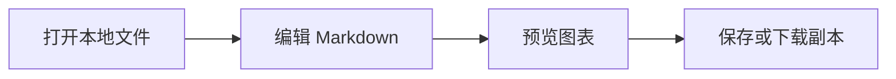

# Directory Studio

把 Chrome 中的本地目录、图片、文本和 Markdown 变成离线工作台：浏览目录、收藏常用位置、查看图片、编辑代码，并预览 Mermaid 图表与 Markmap 脑图。不需要本地服务，不上传文档。

Chrome 扩展是当前主要入口；Tampermonkey（油猴）脚本仍受支持，适合继续使用原生 `file://` 页面。两版共用编辑与图表能力，但安装方式、资源分发和原文件写入权限不同，请勿同时启用两版接管同一文件。

## 选择版本

下表是当前工作树中的版本，尚未推送，不表示 GitHub 安装入口已更新，也不表示已在 Chrome Web Store 发布。

| | Chrome 扩展（主要入口） | Tampermonkey 脚本（另一入口） |
| --- | --- | --- |
| 当前本地版本 | `extension/manifest.json`：1.6.4 | `package.json` / userscript：1.6.2 |
| 安装方式 | 构建后加载 `dist/extension` | 安装 userscript，由 Tampermonkey 管理 |
| 工作方式 | 独立 Manifest V3 工作台，同页切目录、编辑和打开本地链接 | 增强 Chrome 原生目录页与符合条件的原生文本页 |
| 原文件写入 | 显式选择原文件并授权后可以保存 | 不写原文件，只能复制或下载编辑副本 |
| 离线资源 | 全部依赖随扩展包分发 | 安装/更新时下载并校验五个版本化资源，由 Tampermonkey 缓存 |

## Chrome 扩展：安装与更新

需要 Chrome 120 或更新版本。安装本地候选：

1. 在仓库根目录运行 `node extension/build.mjs`。
2. 打开 `chrome://extensions`，开启开发者模式，选择“加载已解压的扩展程序”，选中 `dist/extension`（包含 `manifest.json` 的那一级）。
3. 在扩展详情开启“允许访问文件网址”，并停用同名 Directory Studio 油猴脚本。
4. 用 Chrome 打开本地目录或支持的文件；也可点击扩展工具栏按钮打开空白工作台，在路径栏输入本地路径，或选择文件并授权编辑。

更新时，先保存所有编辑，再重新构建并在扩展管理页点击“重新加载”。扩展重新加载、停用或权限变化可能直接销毁工作台，不要依赖关闭确认框保护尚未保存的内容。

扩展支持外部 `file://` 目录、文本和图片自动转入工作台，也可以暂停自动接管或原生打开。HTML、PDF 和未知二进制保持原生行为。工作台内切目录和打开 Markdown 本地链接不反复加载 Chrome 原生目录；外部首次跳转和冷启动仍可能有短暂过渡，不承诺零帧闪烁。目录列举依赖 Chromium 的目录响应格式，不兼容时可退回原生。

扩展无需 Tampermonkey、运行时网络或本地服务。设计与审查资料见[迁移方案](docs/plans/2026-10-26-extension.md)和[审查记录](docs/reviews/2026-10-26-extension.md)。

## 油猴脚本：安装与更新

1. 在 Chrome 安装 Tampermonkey。
2. 打开[安装 Directory Studio](https://raw.githubusercontent.com/wuyixiang9/directory-studio/main/directory-studio.user.js)，在 Tampermonkey 中确认安装。该链接提供 GitHub `main` 上的版本，不等于尚未推送的本地候选。
3. 在 Chrome 扩展管理页打开 Tampermonkey 详情，开启“允许访问文件网址”；如果显示“允许用户脚本”选项，也需要开启。较旧 Chrome 可能需要开发者模式，按 Tampermonkey 的提示处理。
4. 用 Chrome 打开本地文件夹或支持的原生文本文件。若启用了 Directory Studio 扩展，请先停用其自动接管。
5. 编辑 Markdown 前，请禁用 Markdown Viewer 等会接管该文件的扩展，再重新打开文件。脚本不从已渲染页面反推原文，也不强行覆盖其他应用页面。

正式脚本的 `@downloadURL` 和 `@updateURL` 指向本仓库 `main`，Tampermonkey 可检查更新。安装或更新需要联网取得脚本及 `resources/<版本>/` 下的 `editor.js`、`editor.css`、`markdown.js`、`mermaid.js`、`markmap.js`，并进行 SHA-256 完整性校验；缓存完整后日常使用无需网络。资源下载或校验失败时，请联网重新安装或更新，不要移除完整性校验。

## 目录与图片

### 目录浏览

两版均支持：

- 完整路径面包屑、磁盘或共享根目录、上一级目录和复制路径。
- 当前目录名称搜索、全部/文件/文件夹过滤、自然数字名称或修改时间/大小排序；文件夹始终优先。
- 列表/网格视图、浅色/深色主题，每页最多 160 项；分页不缩减搜索与排序的数据集，不递归扫描子目录。
- 收藏常用目录，当前目录高亮；更多菜单支持改标签、上移、下移和取消收藏，改标签不会重命名磁盘目录。
- 返回历史项时恢复搜索、过滤、排序、视图、分页、滚动位置与焦点；不恢复已弃用的文本侧栏预览或类型/时间条件。

扩展 1.6.4 可收起或展开整个“常用目录”侧栏；宽度不超过 700px 时默认收起，窄屏与宽屏分别记忆选择。目录工作台以 13px 为基础字号，统一页面表面与蓝色强调色；这不是整页缩放，编辑器和 Markdown 预览没有随目录一起缩小。

扩展读取新目录时保留原列表，就绪后一次更新；较慢读取才在底部状态栏提示，连续点击只采用最新结果，失败保留原目录。

快捷键：`/` 聚焦目录搜索；`Escape` 清空或离开搜索；非输入控件内 `Alt+↑` 返回上级目录。油猴保留原生链接的 Ctrl-click、中键和上下文菜单；扩展内的本地链接由工作台路由处理，不把原生页面的所有打开行为视为相同。

### 图片查看

两版使用共享的当前页图片查看器，支持 JPG/JPEG、PNG、GIF、WebP、AVIF、BMP、ICO、SVG；实际显示能力取决于浏览器。SVG 只作为图片嵌入，不作为可执行文档。

- 普通点击打开查看器并保留目录现场；按打开时完整筛选与排序结果切图，跨列表分页但不进入子目录，首尾不循环。相邻缩略图显示当前图片前后各最多 10 张。
- 支持适应窗口、100%、缩放、放大后拖动、左右 90 度旋转和缩略图开关；旋转只影响本次查看，不修改原图，切图重新适应窗口。
- `←` / `→` 切图，`R` / `Shift+R` 向右/左旋转；`Esc` 先收起复制菜单，再关闭查看器并回到图片条目。
- 复制路径、文件名、图片是三个独立操作。复制图片使用未旋转的原始像素，上限为 16 MP（16,777,216 像素）、单边不超过 16384 像素；失败会明确报错，不回退复制其他内容。
- 图片与可见缩略图按需加载，缩略图最多两路并发；损坏图片仍可继续切换，关闭时清理加载和监听。

复制图片受页面来源、画布与剪贴板权限限制：已验证的油猴 `file://` 环境会阻止画布导出，这一限制不能直接当作扩展页面的验证结论。无法直接复制时，可“打开原图”后使用浏览器右键菜单；独立原图页面由浏览器处理。

## 编辑与保存

### 共用编辑能力

CodeMirror 提供行号、语法高亮、缩进、括号匹配、撤销/重做与自动换行。支持 TXT、LOG、Markdown、JSON/JSONC、JavaScript/TypeScript/JSX/TSX、Python、Rust、Go、C/C++、Java、C#、CSS/SCSS、YAML/TOML/INI、Shell、PowerShell、SQL 等；BAT/CMD 等没有专用 lexer 的格式按纯文本显示。

扩展识别 `.md`、`.mdc`、`.markdown` 为 Markdown；MDC 的 frontmatter 只是文档内容，不执行其中规则或指令。油猴编辑组件虽然认识 `.mdc`，入口 bootstrap 尚未自动接管该后缀，不应据此认为两版都可直接打开 MDC。油猴仅接管 Chrome 已作为普通文本展示的页面；XML 也必须满足该条件，HTML、SVG/XML viewer、PDF、独立图片页和未知二进制不会被文本编辑器接管。

- `Ctrl+F` / `Cmd+F` 查找字面文本，Enter 下一处、Shift+Enter 上一处、Escape 返回编辑器；搜索计数显示至 10,000+。
- “复制全文”包含当前未保存修改，失败时仍可手动全选复制。
- “原始文本”与“返回编辑器”切换不清空编辑状态。
- JSON 格式化验证成功后才替换页面内容，保留数值字面量和重复键，避免解析重建导致大整数舍入；另有 128 层嵌套和输出大小保护。

文本编辑上限为 2 MiB / 50,000 行：油猴超限保留原生文本，扩展拒绝装载超限文本。Markdown 超过 512 KiB 暂停预览。

### 原文件与副本：两版语义不同

| 操作 | Chrome 扩展 | 油猴脚本 |
| --- | --- | --- |
| 打开外部文件 | 只读装载，编辑尚未写入磁盘 | 读取 Chrome 解码后的原生 PRE，编辑尚未写入磁盘 |
| “保存原文件”或 `Ctrl+S` / `Cmd+S` | 选择同名原文件、授予写权限并确认目标后保存；已有句柄时复用 | 快捷键下载编辑副本，不覆盖原文件 |
| “下载编辑副本” | 下载如 `notes.edited.md` 的 UTF-8 副本，不写原文件 | 同左；下载不代表原文件已保存 |
| “复制全文” | 只复制当前内容，不保存 | 同左 |

扩展保存前比较打开时的原始字节，保留 UTF-8 BOM 和一致的换行符；非 UTF-8、二进制、混合换行或磁盘外部修改会阻止原位保存。浏览器文件选择器不提供完整路径，因此即使文件同名、字节相同，也需要用户确认选中了正确原文件。首次授权成功后，本页后续保存可复用该句柄。

通过扩展“选择文件并授权编辑”打开时可直接使用文件句柄，但扩展不知道其绝对路径，相对本地链接会提示无法定位；显式 `file://` 链接仍可使用。油猴的输入来自浏览器解码结果，不承诺原始编码、BOM 或换行逐字节保留，下载为 UTF-8，换行可能归一化为 LF。

“已修改（仅页面）”不表示已保存。两版会保护正常关闭或文件切换时的脏编辑，撤销回初始内容可恢复未修改状态；浏览器是否显示离开确认取决于交互策略。下载副本和复制都不会假称原文件已保存，修改扩展权限或重新加载前务必先保存。

## Markdown、Mermaid 与 Markmap

Markdown 支持编辑、预览、分栏，小屏分栏上下排列。普通代码围栏保持代码显示；围栏语言的第一个词为 `mermaid` 或 `markmap` 时渲染相应图表，大小写不敏感。

````markdown


```markmap
# 知识工作台
## 项目规划
- 需求
  - 用户反馈
## 学习笔记
- 核心概念
```
````

### Mermaid 静态图表

支持基础流程图、时序图、类图、状态图、ER 图、甘特图、饼图与 Git 图；其余类型不在当前支持范围。图表保留“查看图表源码”，失败时显示错误和源码，不用 SVG 替换原文。

每图可切换“固定高度 / 自动撑开”：默认自然撑开，固定后图像区域最多 640px、图内滚动，短图不强制留白。选择按相同源码及重复次序在当前页面保留，不改文件；图表定义变化、移出可渲染范围或刷新后恢复默认。

每次预览最多 12 图，每块最多 30 KiB，边数配置上限 200；启动和单图渲染各有 8 秒等待上限。这是依赖浏览器调度的超时，不是独立进程的硬 CPU 限额。图表按预览宽度缩放，宽时间轴在小屏或分栏中可能字号过小；可改用完整预览、增大窗口或简化图表，当前不提供图内缩放。

### Markmap 交互脑图

脑图默认显示根节点和第一层，可点击圆点展开/收起、拖动平移、滚轮缩放；卡片提供“适应窗口”“全部展开”“全部收起”“查看脑图源码”。完整示例见 [markmap-demo.md](test/fixtures/markmap-demo.md)。

标签只保留纯文本，不保留粗斜体；图内链接不导航，图片、HTML、frontmatter、文档驱动 JS/CSS 和 Transformer 插件不启用。主题、编辑、模式或视图变化会重置交互状态。

仅在有效脑图画布进入可见区域且页面位于前台时启动；未显示的脑图等待，不访问运行时 CDN。每块最多 30 KiB / 600 行，每次最多 6 块，转换结果最多 300 节点、深度 20；启动与首次渲染累计可见等待上限 10 秒，离屏或后台暂停计时，并非硬 CPU 限额，失败保留源码。使用 Markmap lib/view 0.18.12 和 D3 7.9.0 browser distribution。

## 安全边界与限制

- 不自动写入、删除或重命名文件；只有扩展中明确授权的保存会写原文件。不上传文档，也不持久化文件正文；本机保存界面偏好、收藏路径/标签，扩展还可保存用户选择的文件句柄。历史位置不包含正文。
- Markdown 原始 HTML 不启用，普通图片只显示“未加载”标签，链接仅在用户点击后导航；这些规则不因图表功能放宽。
- 图表在仅允许脚本、无同源权限的隔离 iframe 内处理，CSP 拒绝网络和外部资源。扩展依赖随包分发，油猴依赖安装缓存；按需启动不代表访问运行时 CDN。
- Mermaid 使用 strict 配置，禁止图内配置指令、frontmatter 配置、点击回调、图片、图标包、外部字体、HTML 标签和交互链接。输出 SVG 经清理后转为本地 Blob 图像，不把 SVG 样式插入编辑器主文档。
- Markmap 的交互 SVG 只在隔离 iframe 内活动，标签重建为转义文本，不把文档脚本、样式或活动链接交给渲染器。编辑、主题、视图变化会废弃过时渲染并撤销相关 Blob URL。
- Markdown 预览自动加载的图像仅限受控生成的 Mermaid 图像；目录图片查看器在用户选择后加载本地图片。此工具不是操作系统沙箱，也不承诺首帧、首次库解析或所有操作的性能改善。

## 开发、构建与测试

需要 Node.js 22.12 或更新版本；基本构建和 Node 测试不需要 `npm install`。以下命令均在仓库根目录执行：

```sh
node extension/build.mjs
node build.mjs
node --test
```

| 命令 | 职责与产物 |
| --- | --- |
| `node extension/build.mjs` | 根据扩展 manifest、共享源码及 vendor 构建 `dist/extension`，依赖随包分发；不改油猴入口和资源 |
| `node build.mjs` | 根据 `package.json` 和 userscript 源版本生成 `directory-studio.user.js`、`directory-studio.meta.js` 及对应的五个版本化资源；当前本地目标为 `resources/1.6.2/` |
| `node --test` | 原版及扩展的单元、构建、安全约束与资源一致性测试；不能替代真实 Chrome/Tampermonkey 验收 |

不要手工编辑生成文件。扩展补丁版本可独立于油猴版本；共享源码变化是否需要更新两种产物，应按实际影响判断。更新油猴正式版本时同步源码 `@version`、`package.json` 和 `CHANGELOG.md`，重新生成两个入口与五个资源，并一起提交。正式入口引用 GitHub raw 的版本化资源和 SHA-256 SRI；保留已发布资源目录，后续变化使用新版本目录，不能覆写旧版破坏其完整性。

可选浏览器集成测试：`node scripts/extension-browser.mjs`，需要 Playwright 及其 Chromium。可用 `DIRECTORY_STUDIO_PLAYWRIGHT` 指定 Playwright 包路径，用 `PLAYWRIGHT_BROWSERS_PATH` 指定浏览器缓存；测试使用独立配置目录，不改日常浏览器。

Node 测试覆盖目录、收藏和跨页状态、图片查看器、文本与 JSON 格式化、构建隔离及确定性、资源 SRI、图表安全和可见性预算等。真实安装、离线资源、CSP、编辑保存和异步竞态仍需浏览器验证；本地或拦截测试不代表 GitHub 安装入口已可用，推送后还应回读公开路径。依赖来源、版本和完整性见 `vendor-manifest.json`，上游原件与许可见 `vendor/`。

### 油猴的可选本地候选

本地候选须显式使用 `--local`，指定未使用过的 `<正式版本>-local.N`；不会覆盖正式入口或已有候选目录，也不会自动启动服务。以下为 Git Bash 示例，版本须选取未占用编号：

```sh
DIRECTORY_STUDIO_LOCAL_VERSION=1.6.2-local.1 DIRECTORY_STUDIO_INSTALL_PORT=43819 DIRECTORY_STUDIO_ARTIFACT_ROOT=../artifacts/chrome-directory-studio/release-local node build.mjs --local
DIRECTORY_STUDIO_ARTIFACT_ROOT=../artifacts/chrome-directory-studio/release-local node serve-install.mjs
```

打开服务打印的安装链接。本地 metadata 使用 loopback 资源地址，不含正式更新入口；缓存完成后可以停止服务。未指定产物目录时使用 `../artifacts/chrome-directory-studio/local-build/`；服务只读取明确允许的七个生成文件，不服务仓库或用户文档。提交、推送、创建 tag 和 Release 是不同操作，构建不会自动发布。

## 许可

仓库自身代码尚未指定许可证，不应默认按第三方 MIT 许可证解释。CodeMirror、markdown-it、Mermaid 和 Markmap 包附有 MIT 许可，D3 附有 ISC 许可；standalone/browser distributions 还包含依赖各自的许可声明，请以 `vendor/` 中的 LICENSE、THIRD-PARTY-NOTICES 及原始 bundle 声明为准，不把全部打包依赖归为单一许可证。

_本内容由 wuyixiang 使用 GPT-6 Astra 辅助完成。_
